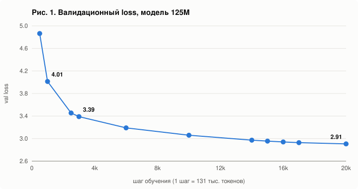
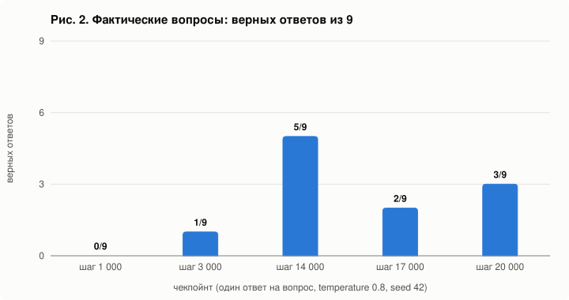

# Эксперимент 1: модель 125M, английский язык

[← К README](../README.md) · [Сравнение с Qwen2.5-0.5B](qwen-comparison.md) · [Инференс](inference.md)

## 1. Модель

| Параметр | Значение |
|---|---|
| Параметров | 100,1 млн |
| Слоёв | 12 |
| Размерность модели | 768 |
| Голов внимания (Q / KV) | 12 / 4 |
| Размер FFN | 2048 |
| Контекст, токенов | 1024 |
| Словарь BPE | 32 000 (EN) |
| Конфиг | `configs/server-125m.json` |

Название «125M» условное: так обозначается класс моделей размера GPT-2 small.
Из-за GQA и общих эмбеддингов фактическое число параметров меньше, ≈100 млн.

## 2. Данные

| Источник | Содержание | Объём, символов | Доля |
|---|---|---|---|
| FineWeb-Edu, `sample-10BT` [1] | образовательные веб-страницы | 12 млрд | ≈86 % |
| smol-smoltalk [2] | диалоги ассистента | 2 млрд | ≈14 % |

Источники перемешиваются пропорционально объёму в течение всего обучения.
Последние 2 % потока токенов отложены для валидации.

## 3. Обучение

| Параметр | Значение |
|---|---|
| Токенов на шаг | 131 072 (16 × 8 накоплений × 1024) |
| Шагов | 20 000 |
| Всего токенов | 2,62 млрд (≈26 на параметр) |
| Оптимизатор | AdamW, пиковый lr 6·10⁻⁴, warmup 1000 шагов, косинусное затухание |
| Точность | bf16, мастер-копия весов в fp32 |
| Оборудование | 1 × NVIDIA RTX A5000 24 GB (аренда) |
| Скорость | 1,59 с/шаг, ≈82 тыс. токенов/с |
| Время и стоимость | ≈8,8 ч, ≈0,5 тыс. ₽ |

## 4. Результаты

### 4.1. Валидационный loss



Loss снижается с 4,01 на шаге 1000 до 2,906 на шаге 20 000 (рис. 1). Основное
снижение приходится на первые ≈6000 шагов. После шага 14 000 улучшение
составляет ≈0,015 за 1000 шагов: модель близка к пределу своей ёмкости при
данном объёме данных.

### 4.2. Качественная оценка

Чекпойнты проверялись на фиксированном наборе из 50 вопросов на английском
(`tasochka/eval.py`) в десяти категориях: диалог, личность, факты, рассуждения,
инструкции, код, творчество, эмоции, контекст, вопросы с подвохом. Генерация:
temperature 0,8, top-k 50, top-p 0,92, seed 42, по одному ответу на вопрос.
Ответы оценивались вручную. Полные ответы на каждом сохранённом шаге
(1000, 3000, 14 000, 17 000, 20 000) лежат в [evals/](evals/).



**Таблица 1.** Результаты по категориям.

| Шаг | val loss | Верных фактов (из 9) | Арифметика и логика (из 7) | Ответ на «Who are you?» |
|---|---|---|---|---|
| 1 000 | 4,01 | 0 | 0 | не по теме |
| 3 000 | 3,39 | 1 | 0 | «новичок в искусстве» |
| 14 000 | 2,97 | 5 | 0 | «человек, который помогает» |
| 17 000 | 2,93 | 2 | 0 | «немного мечтатель» |
| 20 000 | 2,91 | 3 | 0 | «I'm your AI assistant» |

Число верных фактов меняется немонотонно (5 → 2 → 3), хотя loss всё время
падает. Это не деградация модели, а шум оценки: на каждый вопрос взят
единственный случайный ответ, и при temperature 0,8 факт, который модель «знает»
с вероятностью 50–60 %, то появляется, то нет. Для надёжного сравнения нужны
несколько seed на вопрос и жадная генерация. Устойчивых результатов три:

1. **Формат ассистента появляется рано**, к шагу 3000: приветствие, списки,
   блоки кода, структура «вот три совета».
2. **Факты усваиваются медленно и остаются нестабильными:** Токио и 1945 год
   модель называет верно, Мону Лизу приписывает Тициану, а крупнейшей планетой
   называет Венеру.
3. **Арифметика и логика отсутствуют** на всех шагах. Модель воспроизводит
   стиль решения задач из обучающих данных («To find 23 + 47, we…»), но не
   выполняет вычисление.

### 4.3. Примеры ответов

Ответы приведены без правок: оригинал на английском и перевод.

<details>
<summary><b>«Hi there!»</b> — приветствие</summary>

| Шаг | Ответ модели | Перевод |
|---|---|---|
| 1 000 | I'd love to hear you at your friends and I wanted to meet for a call to discuss the article. Best regards, Emily … | Хотела бы услышать вас у ваших друзей, я хотела встретиться и обсудить статью. С уважением, Эмили … |
| 3 000 | Hello! How can I help you today? | Привет! Чем могу помочь? |
| 20 000 | Hello! How can I help you today? | Привет! Чем могу помочь? |

На шаге 1000 модель продолжает текст как письмо. С шага 3000 ответ стабилен.
</details>

<details>
<summary><b>«What is the capital of France?»</b> — факт</summary>

| Шаг | Ответ модели | Перевод |
|---|---|---|
| 1 000 | To find the capital of France, you can use the built-in money supply chain. In the first quarter of this year, the city's initial budget is $305000. … | Чтобы найти столицу Франции, можно использовать встроенную цепочку денежного предложения. В первом квартале бюджет города составил $305 000. … |
| 3 000 | The capital of France is Paris. The capital of the Kingdom of Great Britain, which is situated in the city's heart and most famous landmarks. | Столица Франции — Париж. Столица Королевства Великобритания, которая находится в сердце города и его известнейших достопримечательностях. |
| 14 000 | Paris is a city located in the West Bank of France, approximately halfway between Paris and Rome. … | Париж — город на Западном берегу Франции, примерно на полпути между Парижем и Римом. … |
| 20 000 | France is a country located in the southern part of the United Kingdom, and it has a population of over 10 million people. … | Франция — страна на юге Соединённого Королевства с населением более 10 млн человек. … |

Пример нестабильности фактов: верный ответ на шаге 3000, неверный на шаге 20 000.
</details>

<details>
<summary><b>«What is the capital of Japan?»</b> — факт</summary>

| Шаг | Ответ модели | Перевод |
|---|---|---|
| 14 000 | The capital of Japan is Tokyo. It's the most populous city in the country, and it has a population of approximately 8 million people. | Столица Японии — Токио. Это самый населённый город страны, население около 8 млн человек. |
| 20 000 | The capital of Japan is Tokyo, a country famous for its history and culture. It was founded in the year 1603 by Emperor Gogurye I … | Столица Японии — Токио, страна, известная своей историей и культурой. Основана в 1603 году императором Гогурье I … |

Первое предложение верное, продолжение выдумано.
</details>

<details>
<summary><b>«Give me three tips for better sleep.»</b> — инструкция</summary>

| Шаг | Ответ модели | Перевод |
|---|---|---|
| 1 000 | It's great to start by thinking about this one. Start with a few key things: - Take care of yourself. Don't let the other two kids come together … | Хорошо начать с размышлений. Начните с нескольких ключевых вещей: — Позаботьтесь о себе. Не позволяйте двум другим детям собираться вместе … |
| 14 000 | Improving sleep quality is essential for overall well-being … Here are three tips: First, establish a consistent sleep routine. … | Качество сна важно для общего самочувствия … Вот три совета: во-первых, заведите постоянный режим сна. … |
| 20 000 | Improving sleep quality is crucial for overall well-being and productivity. Here are three tips to help you improve sleep: 1. **Proper Sleep**: Prioritize quality sleep by establishing a consistent sleep schedule … | Качество сна важно для самочувствия и продуктивности. Вот три совета: 1. **Правильный сон**: соблюдайте постоянный режим, просыпайтесь в одно и то же время … |

Структура ответа (вступление, нумерованный список, выделение) сформирована
полностью. Содержание частично осмысленное.
</details>

<details>
<summary><b>«Write a Python function that reverses a string.»</b> — код</summary>

Шаг 3 000:
```python
def reverse_string(s):
    s = ''.join(reversed) for s.isalnum()
    return s == s[::-1]
```

Шаг 14 000:
```python
def reverse_string(s):
    return s[::-1] + '\n'.join([c for c in s if c.isalnum())]
```

Шаг 20 000:
```python
def reverse_string(s):
    return s.reverse()
```

Модель знает имя функции и формат блока кода, на шаге 14 000 появляется верный
приём `s[::-1]`. Ни один вариант не работает: у строк в Python нет метода
`reverse()`.
</details>

<details>
<summary><b>«What is 23 + 47?»</b> — арифметика</summary>

| Шаг | Ответ модели (начало) |
|---|---|
| 3 000 | To find the 23 + 47, we need to subtract 12 from both sides of the equation. … |
| 14 000 | The formula for finding the remainder of a polynomial equation is … This means that the remainder when 17^2005 is divided by 7 is 25. |
| 20 000 | To find 23 + 47, we can first simplify the expression for 23 and 7. 3 * 17 = 27 + 9, 17 * 2 = 54, 54 * 18 = 148 … |

Перевод не приводится: ответы — бессмысленная последовательность вычислений.
Модель воспроизводит вид решения математической задачи, но не складывает числа.
</details>

<details>
<summary><b>«Who are you?»</b> — личность</summary>

| Шаг | Ответ модели | Перевод |
|---|---|---|
| 1 000 | Let's analyze the data from this dataset and explore its impact on your research process. | Давайте проанализируем данные из этого набора и их влияние на ваше исследование. |
| 3 000 | I'm a bit of a beginner who's been at the art for over 20 years now … | Я немного новичок, занимаюсь искусством уже больше 20 лет … |
| 14 000 | I'm the person who helps me navigate through my mental and physical health issues. … | Я человек, который помогает мне справляться с проблемами психического и физического здоровья. … |
| 20 000 | I'm your AI assistant, my young apprentice in the realm of creative writing. I can assist with a wide range of projects … | Я ваш ИИ-ассистент, мой юный ученик в мире творческого письма. Могу помочь с самыми разными проектами … |

Устойчивой личности у модели нет: на этапе предобучения её этому не учили.
Это задача этапа SFT — дообучения на диалогах.
</details>

## 5. Ограничения

- Модель знает только английский язык.
- Оценка качества ручная, на 50 вопросах с одним ответом на вопрос, поэтому
  разница между соседними чекпойнтами в пределах шума.
- Логи обучения сохранились не полностью; рис. 1 построен по
  валидационным точкам из журнала сервера.

## Литература

1. Penedo G. et al. The FineWeb Datasets: Decanting the Web for the Finest Text
   Data at Scale. 2024. arXiv:2406.17557.
2. Allal L. B. et al. SmolLM2: When Smol Goes Big. 2025. arXiv:2502.02737.
