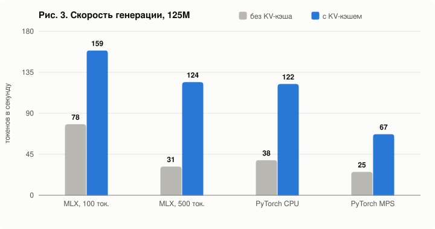

# Инференс: KV-кэш

[← К README](../README.md) · [Эксперимент 125M](experiment-125m.md) · [Сравнение с Qwen2.5-0.5B](qwen-comparison.md)

Первая версия генерации на каждом шаге заново обрабатывала весь контекст. Время
шага росло с длиной ответа, а MLX сохранял в кэше буферы каждого нового размера:
≈18 МБ на токен. Ответ длиной несколько сотен токенов исчерпывал 16 ГБ памяти
Mac. В текущей версии добавлен KV-кэш с буфером фиксированного размера:
промпт обрабатывается за один проход, далее на каждом шаге вычисляется один
токен, а размер кэша MLX ограничен 1 ГБ.

При жадной генерации новая реализация выдаёт ту же последовательность токенов,
что и старая (проверено на 500 токенах для MLX и на 100 для PyTorch). Кэш MLX
при генерации 2000 токенов не превышает 0,48 ГБ и не растёт с длиной ответа.

Когда ответ упирается в длину контекста, кэш пересобирается из последних ¾
контекста, и генерация продолжается без роста памяти.

Код: `tasochka/sampling.py` (общий цикл генерации для обоих бэкендов),
`KVCache` в `tasochka/model_mlx.py` и `tasochka/model_torch.py`.
